
<a href="https://github.com/liwidale?tab=repositories"></a>
<!-- projects:start -->
<a href="https://github.com/liwidale/notyet"></a><a href="https://github.com/liwidale/dropzone"></a>
<a href="https://github.com/liwidale/localhost"></a><a href="https://github.com/liwidale/claude-portable"></a>
<a href="https://github.com/liwidale/lolzteam-api-ts"></a><a href="https://github.com/liwidale/liauth"></a>
<!-- projects:end -->

<!-- contact:start -->
<a href="https://t.me/liwidale"></a><a href="https://x.com/liwidale"></a>
<a href="https://www.reddit.com/user/liwidale/"></a>
<a href="https://matrix.to/#/@liwidale:matrix.org"></a><a href="https://discord.com/app"></a>
<!-- contact:end -->


art: holo from spice and wolf (© isuna hasekura), fan art by likunea

ゝ made by <a href="https://github.com/liwidale">liwidale</a>

